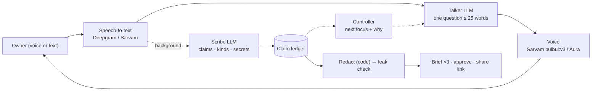

# Birbal

**Akbar had Birbal. Now every builder does.** · *Problem bolo, Birbal samjhega.*

Birbal is a voice interviewer that turns a messy problem into a brief a builder can act on. It asks the way a good investigator does, one question at a time, about what actually happened. It grades every claim as seen, heard, guessed or wished. When you mention a name or a number, it asks right then whether builders may see it. At the end you get three versions of the brief, redacted by code, and nothing is shared until you approve.

Built solo for the AI Garage × Paytm Voice AI Buildathon (Challenge 2: Problem Intake Agent), on a ₹0 stack.

## What's different

- **Debrief, not survey.** No fixed question list. A deterministic controller scores nine dimensions after every answer and picks the next focus. The screen shows *why* ("Asking because: only an adjective, needs a number").
- **Every claim is graded.** Dekha · Seen, Suna · Heard, Socha · Guessed, Chahiye · Wished. Each line of the brief links to the exact quote and the moment it was said.
- **Consent at the moment of disclosure.** "You mentioned Kaveri Bank. Fine for builders to see, or keep that internal?"
- **Redaction by code, before any AI sees the text.** A leak check then blocks approval if a secret slips into a shareable version.
- **Three audiences from one ledger.** For me (everything, with quotes), For builders (redacted, with "where to start"), For everyone (a three-line teaser). Approval mints a read-only share link.
- **Two AI roles, like an interviewer and a note-taker.** The Talker asks; the Scribe grades in the background, so the conversation never waits on note-taking.

## How it works



More in [docs/ARCHITECTURE.md](docs/ARCHITECTURE.md).

## Run it

```bash
uv sync
cp .env.example .env     # add keys: GOOGLE_API_KEY or GROQ_API_KEY for text; + DEEPGRAM_API_KEY for voice
uv run uvicorn api:app --app-dir server --port 8000
```

Open http://localhost:8000. **Type instead** works with just an LLM key. **Start interview** (voice) also needs Deepgram (or Sarvam) and a TTS key. Interviews are saved under `data/sessions/`, resume after a refresh, and can switch from voice to typing mid-way.

```bash
uv run pytest -q                              # no keys needed
uv run python server/simulate.py              # interview-quality scorecard (needs LLM keys)
./scripts/serve_lan.sh                        # use from a phone on the same network (HTTPS)
```

Languages: Auto (follows Hinglish), English, हिंदी, ಕನ್ನಡ. The brief is always in English.

## Stack (₹0)

Pipecat (BSD-2) · Google Gemini and Groq free tiers · Deepgram signup credit · Sarvam credit · FastAPI · plain HTML/JS.

## Honest limits

- The leak check catches exact and number-normalised matches, not paraphrases. That's why redaction runs before any AI rewrite.
- Free AI tiers may use your data to improve their products. Use paid tiers for real confidential work.
- Voice over the internet needs a TURN server (Daily transport or Pipecat Cloud). On a laptop or LAN it works as is.
- No login. The session id acts as the owner's key.

## Roadmap

Push the ledger into Linear or Jira · switch the voice's language mid-interview · merge several owners' interviews into one brief · a builder-side "accept this problem" flow.
