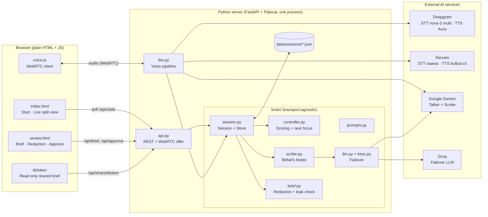
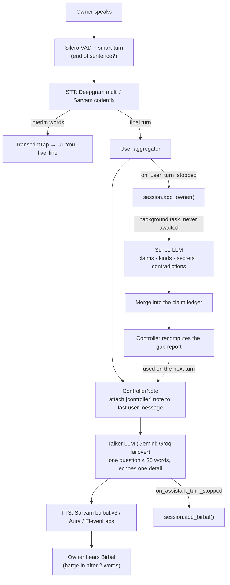
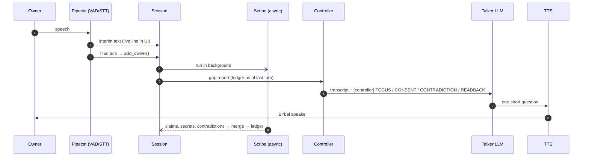
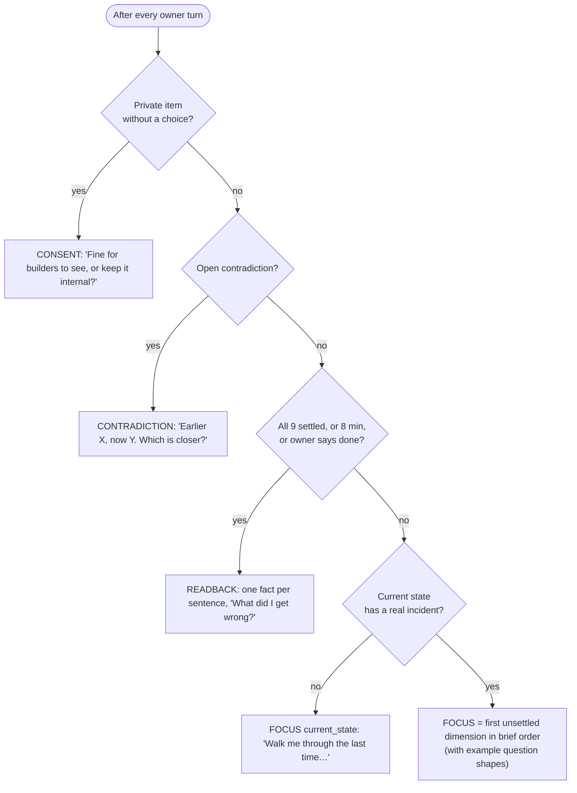
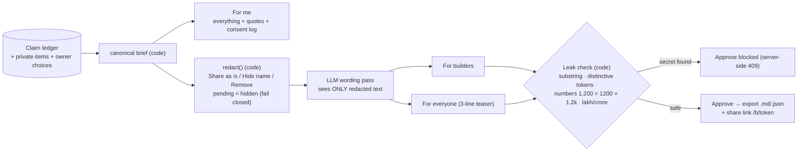
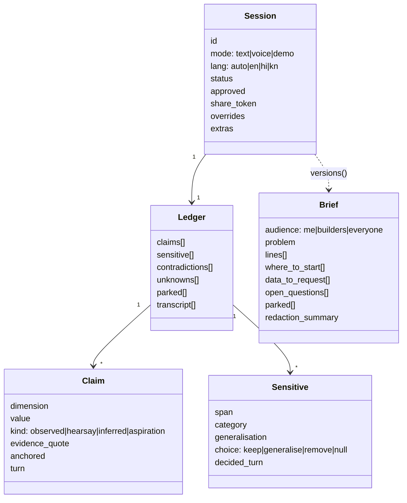

# Birbal: architecture and system design

*"Akbar had Birbal. Now every builder does."*

Birbal interviews a problem owner by voice or text. It grades every claim as it goes (Dekha, Suna, Socha or Chahiye), asks for consent the moment something private is said, and writes a brief that has been redacted by code into three versions. Nothing is shared until the owner approves.

---

## 1. System overview

---

## 2. One voice turn (the hot path)

**Why the Talker never waits for the Scribe:** the Scribe is off the hot path and lags one turn. The Talker always sees the raw latest answer, plus the controller note built from everything up to the previous turn. Latency equals STT + one LLM call + TTS, never two LLM calls.

---

## 3. One turn as a sequence

---

## 4. Controller: how Birbal picks the next question

**Scoring per dimension:** `0` = nothing; `1` = only Socha/Suna or adjectives; `2` = Dekha (observed) plus an anchor (a number, a role or an incident). An "I don't know" with a lead ("ask the platform team") counts as settled.

**The 9 dimensions:** current state · who · workaround · impact · frequency · constraints · already tried · confidential · success test.

---

## 5. Redaction pipeline (code first, AI second)

Known limit, stated openly: a paraphrase ("about twelve hundred") isn't caught by the leak check. That's why redaction runs **before** any AI ever sees text meant for builders.

---

## 6. Reliability and failover

```mermaid
flowchart TD
    subgraph Text["Typed turn / Scribe / brief extras"]
        T1["Preferred provider<br/>(Talker: Gemini · Scribe: Gemini)"] --> T2["Each key in pool<br/>GOOGLE_API_KEYS=k1,k2"]
        T2 -- "429 / quota → rest key 60 s" --> T3["Next key"]
        T3 -- "all keys failed" --> T4["Next provider (Groq pool)"]
        T4 -- "all failed" --> T5["Clear error; owner retries;<br/>failed turn retracted (no duplicates)"]
    end
    subgraph Voice["Voice interview"]
        V1["Start: pick healthy provider + key"] --> V2["Pipeline running"]
        V2 -- "fatal error, or 2 errors in 10 s" --> V3["status = error"]
        V3 --> V4["UI auto-switches to typing<br/>same session, nothing lost"]
        V2 -- "page refresh / tab closed" --> V5["Disconnect ≠ end;<br/>resume by typing"]
    end
    subgraph Data["Data safety"]
        D1["Autosave every 5 s (dirty sessions)"] --> D2["Atomic write: tmp → rename"]
        D3["Server restart"] --> D4["Session restored from disk"]
    end
    subgraph Fallback["Last-resort demo"]
        F1["/start?demo=1 → replay fixture<br/>drives the real UI, no keys needed"]
    end
```

---

## 7. Data model

Every bonus point comes from one structure, the ledger:
- **Missing info:** unscored dimensions plus unknowns.
- **Facts vs assumptions:** `kind`.
- **Sensitive info:** `sensitive[]`.
- **Help redact:** `choice`.
- **Per-audience versions:** `versions()`.

---

## 8. API surface

| Method | Path | Purpose |
|---|---|---|
| GET | `/api/health` | readiness (AI, voice, key counts, TTS) |
| GET | `/api/sessions` | recent briefs (redacted titles) |
| POST | `/api/start?mode=text\|voice\|demo&lang=auto\|en\|hi\|kn` | new interview → `id` |
| GET | `/api/state?s=` | live state for the UI (rows, focus, why, interim, private, open, parked) |
| POST | `/api/turn?s=` | typed answer → Birbal's reply |
| POST | `/api/mode?s=&mode=text` | switch voice → typing mid-interview |
| POST | `/api/end?s=` | finish, wait for the Scribe, save |
| GET | `/api/brief?s=` | three versions + leaks + private items + share link |
| POST | `/api/choice?s=` | Share as is / Hide name / Remove (revokes the share link) |
| POST | `/api/edit?s=` | hand-edit the problem statement (leak-checked) |
| POST | `/api/approve?s=` | server-side leak gate → export + share token |
| GET | `/api/export/{audience}.{md\|json}?s=` | download (shareable versions only after approval) |
| GET | `/api/shared/{token}` · `/b/{token}` | read-only builder + public versions |
| POST/PATCH | `/api/offer` | WebRTC offer / ICE for voice (`request_data.session`) |

---

## 9. Design decisions at a glance

| Choice | Why |
|---|---|
| Cascade (STT → LLM → TTS) instead of an all-in-one voice model | a human Indian voice (Sarvam) needs a swappable TTS; every turn's prompt is under our control |
| Talker + Scribe split | low latency (one LLM call on the hot path) plus deep extraction in the background, like an interviewer and a note-taker |
| Deterministic controller | the interview adapts to unseen problems without a fixed question list; testable |
| Redaction in code before AI | confidentiality doesn't depend on asking an AI nicely; enforced server-side |
| Smart-turn + 0.4 s VAD + 2-word barge-in | patient listening without long pauses; noise doesn't interrupt |
| Key pools + provider failover + degrade to typing | the demo never dies on a rate limit or a mic failure |
| Sessions on disk, atomic writes, autosave | several judges, restarts and refreshes are all safe |
| Plain HTML/JS, one CSS token file | enterprise look with zero build step; light theme for projectors |
| ₹0 stack | Gemini / Groq free tiers, Deepgram $200 credit, Sarvam credit, open-source Pipecat |

---

## 10. Deployment

| Setting | How |
|---|---|
| Event demo | laptop: `uv run uvicorn api:app --app-dir server --port 8000` |
| Phone / other laptop | `./scripts/serve_lan.sh` (HTTPS on the LAN IP, self-signed certificate), over a phone hotspot |
| Public, typed only | any long-running Python host + persistent disk (`BIRBAL_DATA`) |
| Public, voice | needs TURN: Pipecat `DailyTransport` (Daily free tier), Pipecat Cloud, or SmallWebRTC + coturn |
| Production must-dos | owner auth, paid AI tiers (free tiers may use data for training), HTTPS, per-session secrets |

**Languages:** Auto (follows Hinglish), English, हिंदी, ಕನ್ನಡ. The interview runs in that language; **the brief is always in English.** Hindi and Kannada voice use Sarvam; Kannada speech recognition uses Sarvam.
